# Fox Mobile — Progress Hub & Map of Content

> [!IMPORTANT] Current Checkpoint (Paused After Phase 5)
> Phases **0, 1, 2, 3, 4, 4.5 (Speed), and 5 (The Fox Line)** are complete, verified on the physical **POCO C71** (`9b010059305331323800204926576c`), benchmarked with `dumpsys gfxinfo`, and committed locally to `main`. Execution is paused before **Phase 6 (The search drawer)**.

## Vault Navigation (`[[WikiLinks]]`)

- **Main AI & Developer Brain (Start Here):** [[PROGRESS]]
- **Interactive Visual Canvas Map:** [[Fox_Mobile_Map.canvas]] *(Open in Obsidian to view the node-and-edge board)*
- **Complete File-by-File Index:** [[File_Map_Index]]
- **Active v30 Components:**
  - [[MainActivity]] (`MainActivity.kt` — App host & refresh rate)
  - [[FoxSpring]] (`FoxSpring.kt` — Spring physics engine)
  - [[FoxTheme]] (`FoxTheme.kt` — 10 exact color tokens & Ink material)
  - [[DepthWallpaperAndClock]] (`DepthWallpaperAndClock.kt` — 3-layer depth & calm tilt)
  - [[WordsRepository]] (`WordsRepository.kt` — Quotes & mountain ridge fit)
  - [[WorkHomeScreen]] (`WorkHomeScreen.kt` — Home work block & Continue pill)
  - [[FoxLineState]] (`FoxLineState.kt` — Urgency queue & activity engine)
  - [[FoxLineCanvas]] (`FoxLineCanvas.kt` — Line touch strip & water ripple)
  - [[IslandCard]] (`IslandCard.kt` — Live Activity card)
  - [[FoxLineDebugMenu]] (`FoxLineDebugMenu.kt` — Clock long-press debug menu)
- **Pending Phases & Protocol:**
  - [[SpotlightSheet]] (`SpotlightSheet.kt` — **LEGACY**: replace in Phase 6)
  - [[FoxProtocol]] & [[FoxLinkClient]] (WebSocket protocol for Phase 13)
  - [[ContractTest]] (`ContractTest.kt` — Verification test suite)
- **Knowledge & Reference:**
  - [[Prototype_Fox_Line_v30]] (Exact prototype line lookup)
  - [[POCO_C71_Hardware_Rules]] (5 golden hardware rules for Unisoc T603)
  - [[02_Mistakes_And_How_We_Overcame_Them]] (All 11 mistakes post-mortem)
  - [[01_Architecture_And_Phase_Progress]] (Architecture breakdown)

---

## Phase Progress Tracker

| Phase | Title | Status | Git Commit | On-Device Verification (`POCO C71`) |
| :--- | :--- | :--- | :--- | :--- |
| **Phase 0** | Set up the Mac and the phone | Done | *(Toolchain)* | OpenJDK 17, Android SDK 35, Gradle 8.11.1, ADB authorized |
| **Phase 1** | Clean up the last attempt | Done | `c76a464` | Deleted C/JNI/CMake/NDK; pure Kotlin `FoxSpring.kt` |
| **Phase 2** | Theme, fonts and the material | Done | `be8a09a` | 10 exact color tokens, SIL OFL fonts, `FoxInkBox` |
| **Phase 3** | The depth wallpaper and the clock | Done | `1b60c30` | 191-point ridge cut, 3-layer stack, accelerometer parallax |
| **Phase 4** | The home content | Done | `d4890d8` | `.work` block at 54% H, `Continue` pill, `Set 7:00`, `#words` |
| **Phase 4.5** | Speed (120Hz vote + R8 benchmark) | Done | `f2cf075` | **`p50=11ms, p90=15ms, p99=16ms, gpu_p90=6ms, janky=0.00%`** |
| **Phase 5** | The Fox Line (the bar) | Done | `2af3bcb` | Urgency queue, 8 bar shapes, Island Card, Clock Debug Menu (`gpu_p50=6ms, gpu_p90=8ms`) |
| **Phase 6** | The search drawer | **Paused (Next)** | — | Spotlight layout (`56% H`), 1:1 drag + springs, real apps |
| **Phase 7** | Send and receive | Queued | — | 1 liquid morphing composable with 6 spring channels |
| **Phase 8** | The dashboard | Queued | — | Pull-down parting painting at the ridge |
| **Phase 9** | Polish pass on the phone | Queued | — | Side-by-side audit against `Fox_Line_v30.html` |
| **Phase 10** | Performance on the POCO C71 | Queued | — | Full-app `gfxinfo` + memory `< 180 MB` verification |
| **Phase 11** | The real ripple *(Optional)* | Queued | — | AGSL `RuntimeShader` displacement |
| **Phase 12** | Show it to Enoch | Queued | — | `screenrecord /sdcard/fox.mp4` walkthrough |
| **Phase 13** | Real data (after UI is approved) | Queued | — | `FoxLinkClient` to `apps/fox-desk` port `8787` |

---

## Visual Journey Map (Mermaid)

```mermaid
flowchart LR
    P0["Phase 0: Mac & POCO C71 Setup"] --> P1["Phase 1: Pure Kotlin FoxSpring (c76a464)"]
    P1 --> P2["Phase 2: Theme, Fonts & Ink (be8a09a)"]
    P2 --> P3["Phase 3: 3-Layer Depth Wallpaper & Clock (1b60c30)"]
    P3 --> P4["Phase 4: Home Work Block & Ridge-Fitted Words (d4890d8)"]
    P4 --> P45["Phase 4.5: Speed Gate 0.00% Jank (f2cf075)"]
    P45 --> P5["Phase 5: Fox Line, Urgency Queue & Island Card (2af3bcb)"]
    P5 -. "PAUSED HERE" .-> P6["Phase 6: Search Drawer"]
    P6 -.-> P7["Phase 7: Liquid Send/Receive"]
    P7 -.-> P8["Phase 8: Ridge-Parting Dashboard"]
```

---

## Live POCO C71 Screenshots Across Phases

### Phase 5 — The Fox Line & Live Activity Island Card (`2af3bcb`)
![[screenshots/phase5_phone.png|340]] ![[screenshots/phase5_island_phone.png|340]]

### Phase 4.5 & Phase 4 — Home Content & Speed Gate (`f2cf075` / `d4890d8`)
![[screenshots/phase4_5_phone.png|340]] ![[screenshots/phase4_phone.png|340]]

### Phase 3 — Depth Wallpaper & 191-Point Ridge Clock (`1b60c30`)
![[screenshots/phase3_phone.png|340]]
