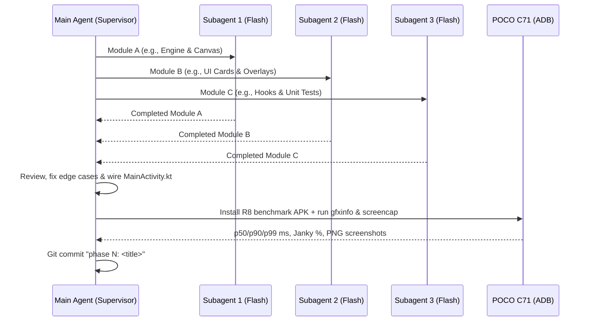

# Architecture & Phase-by-Phase Progress (Phases 0–5)

Back to Hub: [[00_Fox_Mobile_Progress_Hub]] | See Also: [[02_Mistakes_And_How_We_Overcame_Them]]

---

## 1. Multi-Agent Execution Model

For every phase, work is partitioned across **3 parallel Gemini Flash subagents** (`Model: "flash"`) with strict non-overlapping file ownership, followed by main-agent integration, unit testing (`./gradlew testDebugUnitTest`), R8-minified benchmarking (`./gradlew assembleBenchmark` + `adb shell dumpsys gfxinfo com.fox.mobile`), real-device screenshot verification on the **POCO C71**, and a local git commit (`phase N: <title>`).

---

## 2. Detailed Phase Breakdown (What We Built)

### Phase 0: Set up the Mac and the phone
- Installed **OpenJDK 17** (`/opt/homebrew/opt/openjdk@17`), **Android SDK Platform 35 & Build-Tools 35.0.0** (`~/Library/Android/sdk`), and the **`android` CLI** (`~/.local/bin/android`).
- Generated Gradle Wrapper `8.11.1` in `apps/fox-mobile/gradlew`.
- Connected and authorized Enoch's **POCO C71** (`9b010059305331323800204926576c`, model `25028PC03I`, Android 15 HyperOS, `720 × 1640` LCD).

### Phase 1: Clean up the last attempt (`c76a464`)
- Removed all legacy C11/JNI/CMake/NDK code (`apps/fox-mobile/app/src/main/cpp/`, `/tmp/libfox_core.dylib`, `run_contract_tests.sh`).
- Created pure Kotlin [`FoxSpring.kt`](file:///Users/enoch/Desktop/Glass_Main%28me%29/Android%20Launcher%21/apps/fox-mobile/app/src/main/java/com/fox/mobile/core/FoxSpring.kt):
  - `Spring1D` and `SpringChannelSet` supporting both Apple `(response, damping)` conversion (`k = (2π / response)²`, `c = 4π · damping / response`) and direct `(k, c)` stiffness/damping.
  - 4 substeps per frame (`subDt = dt / 4f`) for numerical stability and seamless mid-flight velocity carry-over on `retarget()`.
- Copied `wallpaper.webp` (`1136 × 615`, 59 KB) into `apps/fox-mobile/app/src/main/assets/wallpaper.webp`.

### Phase 2: Theme, fonts and the material (`be8a09a`)
- Bundled real SIL OFL fonts in `apps/fox-mobile/app/src/main/res/font/`:
  - `bricolage_grotesque.ttf` (`FoxFonts.Bricolage`)
  - `figtree.ttf` (`FoxFonts.Figtree`)
  - `jetbrains_mono.ttf` (`FoxFonts.JetBrainsMono`)
- Implemented [`FoxTheme.kt`](file:///Users/enoch/Desktop/Glass_Main%28me%29/Android%20Launcher%21/apps/fox-mobile/app/src/main/java/com/fox/mobile/ui/theme/FoxTheme.kt) with the exact 10 color tokens from `Fox_Line_v30.html`:
  - `screenBg` (`#07080C`), `inkSurface` (`#9914161E`), `inkPanel` (`#BD101219`), `inkMenu` (`#EB141620`), `hair` (`#24FFFFFF`), `t1` (`#F6F0E6`), `t2` (`#ADF6F0E6`), `ember` (`#F2B33D`), `ok` (`#7FD6A4`), `alert` (`#FF4D4D`), `lineWarm` (`#D9F6F0E6`).
  - `FoxInkBox` reusable dark translucent material composable (zero glow, zero halo, zero gradient).

### Phase 3: The depth wallpaper and the clock (`1b60c30`)
- Implemented [`DepthWallpaperAndClock.kt`](file:///Users/enoch/Desktop/Glass_Main%28me%29/Android%20Launcher%21/apps/fox-mobile/app/src/main/java/com/fox/mobile/ui/depth/DepthWallpaperAndClock.kt):
  - `WallpaperBox.calculate(screenW, screenH)`: `ih = 1.1f * H`, `iw = ih * 1136f / 615f`, `left = -(420f / 1136f) * iw`, `top = -0.05f * H`.
  - Embedded all **191 normalized ridge points** (`RIDGE_NORMALIZED_POINTS`) from `docs/prototypes/assets/ridge.json`.
  - 3-layer stack:
    1. **Layer 1 (Back sky painting):** translates by `(tiltX * 5f, tiltY * 4f - 0.20f * H * dashProgress)`.
    2. **Layer 2 (Clock & Date):** at `start = 22.dp, top = 24.5% H`, `118sp` Bricolage Bold (`lineHeight = 0.86em`, `letterSpacing = -0.055em`), tucked behind Layer 3, translating by `(tiltX * 10f, tiltY * 8f - 0.20f * H * dashProgress)`.
    3. **Layer 3 (Front mountain ground painting):** clipped along the 191-point ridge polygon so the bottom of the `118sp` clock digits sits behind the white ridge line, translating by `(tiltX * 18f, tiltY * 13f + 0.52f * H * dashProgress)`.
  - 4. **Layer 4 (Bottom dark fade):** `130.dp` vertical gradient (`Transparent -> #8C050609 at 55% -> #D9050609 at 100%`).

### Phase 4: The home content (`d4890d8`)
- Implemented [`WordsRepository.kt`](file:///Users/enoch/Desktop/Glass_Main%28me%29/Android%20Launcher%21/apps/fox-mobile/app/src/main/java/com/fox/mobile/ui/home/WordsRepository.kt) and `Phase4HomeContent` in [`WorkHomeScreen.kt`](file:///Users/enoch/Desktop/Glass_Main%28me%29/Android%20Launcher%21/apps/fox-mobile/app/src/main/java/com/fox/mobile/ui/home/WorkHomeScreen.kt):
  - `.work` block at `left = 22.dp, right = 22.dp, top = 54% H`:
    - Sentence: *"You were writing **MenuBarView.swift** on your Mac, 4 min ago."* (`23sp` Bricolage, `t2` with `MenuBarView.swift` in `t1` SemiBold).
    - `Continue` pill button: `52.dp` tall, `26.dp` radius, `inkSurface` + `1.dp hair` border, `16sp` Bricolage SemiBold + `18.dp` right arrow (`Continue` → `Sending to your Mac` → `Open on your Mac` → `Continue`).
    - `.next` row: `"Exam tomorrow 9:30 · no alarm"` + `"Set 7:00"` chip firing `AlarmClock.ACTION_SET_ALARM` (`EXTRA_HOUR = 7, EXTRA_MINUTES = 0, EXTRA_SKIP_UI = true`) and flipping to `"Alarm 7:00"` in `ok` mint (`#7FD6A4`).
  - `#words` block `14.dp` above `.work`:
    - 3 prototype quotes (Philippians 4:13 verse, Steve Jobs quote, Fox reminder) selected by time of day (`<12`, `<18`, `>=18`).
    - `selectWordsFit(...)` tests `(0.92f, 16sp)`, `(0.80f, 15sp)`, `(0.68f, 14sp)` against `maxRidgeYInSpan(...)` so the quote never touches the white mountain ridge above it (`>= 10.dp` clearance).

### Phase 4.5: Speed (`f2cf075`)
- Added `requestHighRefreshRate()` in [`MainActivity.kt`](file:///Users/enoch/Desktop/Glass_Main%28me%29/Android%20Launcher%21/apps/fox-mobile/app/src/main/java/com/fox/mobile/MainActivity.kt) (`onCreate` and `onResume`) selecting Mode ID 2 (`120.00001 Hz`), plus R8-minified `benchmark` build type and `androidx.profileinstaller:profileinstaller:1.4.1`.
- Pre-baked screen-sized `backLayerBitmap` and ridge-clipped `frontLayerBitmap` once on load (cutting GPU texture memory by **78%** and eliminating per-frame 191-point stencil clipping).
- Cached the `118sp` clock and `#words` blocks in `CompositingStrategy.Offscreen` GPU layers, moved all animations into `Modifier.graphicsLayer { ... }` lambdas, and calmed the tilt loop to `0 frames/sec` after 1s of stillness.
- **On-device `gfxinfo` result on POCO C71:** `p50 = 11 ms`, `p90 = 15 ms` (passes `≤ 16 ms` gate), `p99 = 16 ms`, `gpu p50/p90/p99 = 6 ms`, **`Janky frames = 0 / 28 (0.00%)`**.

### Phase 5: The Fox Line (`2af3bcb`)
- Created [`FoxLineState.kt`](file:///Users/enoch/Desktop/Glass_Main%28me%29/Android%20Launcher%21/apps/fox-mobile/app/src/main/java/com/fox/mobile/ui/line/FoxLineState.kt), [`FoxLineCanvas.kt`](file:///Users/enoch/Desktop/Glass_Main%28me%29/Android%20Launcher%21/apps/fox-mobile/app/src/main/java/com/fox/mobile/ui/line/FoxLineCanvas.kt), [`IslandCard.kt`](file:///Users/enoch/Desktop/Glass_Main%28me%29/Android%20Launcher%21/apps/fox-mobile/app/src/main/java/com/fox/mobile/ui/island/IslandCard.kt), and [`FoxLineDebugMenu.kt`](file:///Users/enoch/Desktop/Glass_Main%28me%29/Android%20Launcher%21/apps/fox-mobile/app/src/main/java/com/fox/mobile/ui/line/FoxLineDebugMenu.kt):
  - **Urgency queue (`activeList()`):** `XFER` → urgent/done `TIMER` (`<= 10s`) → `MSG` → `CONT` → `ORDER` → normal `TIMER` → `MUSIC` (max 2 items: primary line + secondary `6dp` bead at `12dp` gap; horizontal swipe `> 30dp` swaps them unless timer is ringing red).
  - **8 bar shapes:** `IDLE` (`118×5dp`), `MSG` (drop + neck + sender initial/count), `MUSIC` (`150dp` multi-harmonic wave in album color), `TIMER` (`140dp` countdown bar turning `#F2B33D` at `<35%`, `#FF4D4D` at `<=10s`, and pulsing red when done), `ORDER` (`210dp` track with 3 ticks, steaming bowl, rider pill, and house), `XFER` (`160dp` fill + `TransferRippleCanvas` water rings), `CONT` (`160dp` amber-to-green bar + outward ripple), and `FOX` (`60% W` `#FFB03A` speech wave + glass capsule + bottom `.fox-chips` after 1.1s hold).
  - **Live Activity Island Card (`LiveActivityIslandCard`):** Bottom-anchored (`12dp` side margins, `14dp` bottom, `30dp` radius) card for all 6 activities; hides the Fox Line while open and closes on outside tap.
  - **Clock Long-Press Debug Menu (`FoxLineDebugMenu`):** Long-pressing the clock opens a 10-button Ink menu to trigger every bar state on the phone.
  - **System Gesture Bar Hidden:** Hid Android's bottom navigation gesture bar via `WindowInsetsControllerCompat` so the Fox Line is the sole bottom bar.
