# Mistakes & How We Overcame Them (Phases 0–5)

Back to Hub: [[00_Fox_Mobile_Progress_Hub]] | See Also: [[01_Architecture_And_Phase_Progress]]

> [!NOTE] Purpose of This Document
> Every real bug, architectural misstep, build failure, and performance bottleneck encountered while building **Fox Mobile** on the **POCO C71 (`Unisoc T603`)**, documented with its root cause and the exact fix that solved it.

---

## Summary Map of Mistakes & Fixes

```mermaid
flowchart TD
    M1["Mistake 1: Over-engineered C/JNI/NDK core"] --> F1["Fix 1: Deleted C/JNI; wrote pure Kotlin FoxSpring.kt (180 lines)"]
    M2["Mistake 2: '!' in 'Android Launcher!' broke R.jar zip parsing"] --> F2["Fix 2: Redirected buildDir to /tmp/fox-gradle-build"]
    M3["Mistake 3: Debug build ran at 60Hz with 32% janky frames"] --> F3["Fix 3: Added requestHighRefreshRate() + R8 benchmark buildType"]
    M4["Mistake 4: 24 MB wallpaper bitmap + per-frame 191-pt stencil clip"] --> F4["Fix 4: Pre-baked screen-sized sky & ridge bitmaps once on load (-78% VRAM)"]
    M5["Mistake 5: Tilt loop ran at 60fps forever when phone was still"] --> F5["Fix 5: Added 0.002f deadband + sleep after 1s stillness (0 fps idle)"]
    M6["Mistake 6: Modifier.blur(dp) per-frame + parent recomposition on #words tap"] --> F6["Fix 6: Pre-composed 3 offscreen layers + GPU alpha swap (0.00% jank)"]
    M7["Mistake 7: Notification shade & screencap inside gfxinfo window"] --> F7["Fix 7: cmd statusbar collapse before reset; screencap only after gfxinfo"]
    M8["Mistake 8: FoxLineCanvas read non-State nowSec() inside Canvas"] --> F8["Fix 8: Driven by mutableFloatStateOf(frameNowSec) inside withFrameNanos"]
    M9["Mistake 9: closeFox() never reset foxAwake after 260ms"] --> F9["Fix 9: Added foxCloseT0Sec timer in FoxLineState.tick()"]
    M10["Mistake 10: Android white gesture bar overlapped Fox Line"] --> F10["Fix 10: Hid WindowInsetsCompat.Type.navigationBars() in MainActivity"]
    M11["Mistake 11: AnimatedVisibility + shadow(20.dp) spiked UI thread on Island open"] --> F11["Fix 11: Kept IslandCard composed in tree & animated via graphicsLayer"]
```

---

## Detailed Post-Mortems

### Mistake 1: Over-Engineering the First Attempt with C / JNI / CMake / NDK
- **Phase:** Pre-Phase 1 → Phase 1 (`c76a464`)
- **What went wrong:**
  - In the previous attempt, we built a C11 native library (`fox_core.c`, `fox_jni.c`, `CMakeLists.txt`, `/tmp/libfox_core.dylib`) for spring math and schema checks while leaving the actual Compose UI unfinished, with system fonts instead of Bricolage/Figtree, no depth wallpaper, and unverified layouts.
- **How we overcame it:**
  - Deleted `apps/fox-mobile/app/src/main/cpp/`, `/tmp/libfox_core.dylib`, `run_contract_tests.sh`, and all `externalNativeBuild` / `ndkVersion` blocks in `app/build.gradle.kts`.
  - Replaced `FoxNativeCore.kt` with 180 lines of pure, deterministic Kotlin in [`FoxSpring.kt`](file:///Users/enoch/Desktop/Glass_Main%28me%29/Android%20Launcher%21/apps/fox-mobile/app/src/main/java/com/fox/mobile/core/FoxSpring.kt) (`Spring1D` and `SpringChannelSet`, 4 substeps per frame, velocity carry-over on retarget), verified by JUnit tests (`./gradlew testDebugUnitTest`).

---

### Mistake 2: Exclamation Mark (`!`) in Workspace Folder Path Breaking `R.jar`
- **Phase:** Phase 1 (`c76a464`)
- **What went wrong:**
  - The workspace directory is `/Users/enoch/Desktop/Glass_Main(me)/Android Launcher!`.
  - Java's `JarURLConnection` uses `!/` as the delimiter between a `.jar` file path and its internal zip entry (`jar:file:/path/to/archive.jar!/entry.class`).
  - When Android Gradle Plugin (`processDebugResources`) tried to open `.../Android Launcher!/apps/fox-mobile/app/build/.../R.jar`, the JVM parser split the URL at `Android Launcher!/` and threw a `FileNotFoundException` / zip parsing failure.
- **How we overcame it:**
  - Added `allprojects { layout.buildDirectory.set(file("/tmp/fox-gradle-build/${project.name}")) }` in [`apps/fox-mobile/build.gradle.kts`](file:///Users/enoch/Desktop/Glass_Main%28me%29/Android%20Launcher%21/apps/fox-mobile/build.gradle.kts#L6-L8).
  - All intermediate `.jar` and `.apk` outputs are built in `/tmp/fox-gradle-build/`, completely avoiding the `!` in the path.

---

### Mistake 3: Measuring Performance on a Debug APK & Assuming Automatic 120 Hz
- **Phase:** Phase 3 → Phase 4.5 (`f2cf075`)
- **What went wrong:**
  - Jetpack Compose `debug` builds include unminified reflection, live literals, and debug tracing (`isDebuggable = true`) without R8 optimization. On the POCO C71's entry-level **Unisoc T603** (`8× Cortex-A55`), the `debug` build had **32% janky frames** (`90th percentile = 23 ms`).
  - Furthermore, Android does not automatically switch third-party activities to 120 Hz without an explicit window display mode request, and HyperOS on the POCO C71 has its own firmware refresh-rate policy.
- **How we overcame it:**
  1. Added `requestHighRefreshRate()` in [`MainActivity.kt`](file:///Users/enoch/Desktop/Glass_Main%28me%29/Android%20Launcher%21/apps/fox-mobile/app/src/main/java/com/fox/mobile/MainActivity.kt#L68-L101) (`onCreate` and `onResume`) selecting `Display.Mode` ID 2 (`720×1640 @ 120.00001 Hz`).
  2. Verified via `adb shell dumpsys display` that our vote (`PRIORITY_APP_REQUEST_BASE_MODE_REFRESH_RATE -> RequestedRefreshRateVote{ refreshRate=120.00001 }`) is registered, and documented HyperOS's firmware policy (`mRefreshRateChangeable: false` / `activeMode={id=0, vsyncRate=60.00 Hz}`) in commit `f2cf075`.
  3. Added the R8-minified `benchmark` build type (`isMinifyEnabled = true`, `isShrinkResources = true`, `isDebuggable = false`, signed with debug key) + `androidx.profileinstaller:profileinstaller:1.4.1` in [`app/build.gradle.kts`](file:///Users/enoch/Desktop/Glass_Main%28me%29/Android%20Launcher%21/apps/fox-mobile/app/build.gradle.kts#L28-L37).

---

### Mistake 4: Full `3332 × 1804` (24 MB) Wallpaper Bitmap & Per-Frame 191-Point Stencil Clipping
- **Phase:** Phase 3 → Phase 4.5 (`f2cf075`)
- **What went wrong:**
  - To match `Fox_Line_v30.html`'s `object-fit: cover` crop (`ih = 1.1 * H = 1804 px`, `iw = 3332 px`), our initial Phase 3 code scaled `wallpaper.webp` to a `3332 × 1804` bitmap (**24 MB** in `ARGB_8888`) and clipped the front ground layer using `Modifier.clip(GenericShape { ... 191 ridge points ... })`.
  - On the Unisoc T603's PowerVR GPU, rasterizing a 191-point non-convex polygon clip on every tilt frame forced a hardware `StencilAttachment` pass and consumed `11 ms` of GPU time per frame (`24.75 MB` texture cache).
- **How we overcame it:**
  - In [`DepthWallpaperAndClock.kt`](file:///Users/enoch/Desktop/Glass_Main%28me%29/Android%20Launcher%21/apps/fox-mobile/app/src/main/java/com/fox/mobile/ui/depth/DepthWallpaperAndClock.kt#L637-L674), we pre-bake two screen-sized bitmaps (`(screenW + 64) × (screenH + 64) = 784 × 1704`, only **5.3 MB total — a 78% reduction in GPU texture memory**) once on load:
    - `backBmp`: pre-cropped sky + painting.
    - `frontBmp`: pre-cropped and pre-clipped to the 191-point ridge path once on a CPU `android.graphics.Canvas`.
  - At runtime, both layers are drawn as simple unclipped `drawImage` calls and translated purely on the GPU inside `Modifier.graphicsLayer { translationX = ...; translationY = ... }`.
  - Cached the `118sp` clock with `CompositingStrategy.Offscreen`.
  - **Result:** GPU 50th/90th/99th percentile dropped from `11 ms` to **`6 ms`**, and `StencilAttachment` dropped to `2.00 KB`.

---

### Mistake 5: Never-Ending Accelerometer Tilt Frame Loop When Phone Was Still
- **Phase:** Phase 3 → Phase 4.5 (`f2cf075`)
- **What went wrong:**
  - Accelerometer / gravity sensors emit continuous micro-noise (`±0.0005`), keeping the `withFrameNanos` loop running at 60 fps indefinitely even when the phone sat untouched on the desk.
- **How we overcame it:**
  - In [`TiltParallaxState.updateLowPass()`](file:///Users/enoch/Desktop/Glass_Main%28me%29/Android%20Launcher%21/apps/fox-mobile/app/src/main/java/com/fox/mobile/ui/depth/DepthWallpaperAndClock.kt#L402-L427), we only mutate `tiltX` / `tiltY` when the post-filter delta (`(target - tilt) * 0.08f`) exceeds **`0.002f`**.
  - After **1 second** without suprathreshold movement, the `withFrameNanos` coroutine exits completely (**`0 frames/sec`** scheduled at rest) and suspends on a `Channel<Unit>(Channel.CONFLATED)` until `SensorEventListener` receives real movement (`> 0.002f`).
  - Added a `LifecycleEventObserver` to unregister the sensor listener on `Lifecycle.Event.ON_PAUSE`.

---

### Mistake 6: Animating `Modifier.blur(blurDp)` Frame-by-Frame & Parent Recomposition on `#words` Tap
- **Phase:** Phase 4 → Phase 4.5 (`f2cf075`)
- **What went wrong:**
  - When tapping the `#words` quote to swap to the next quote, our initial Phase 4 code animated `swapBlur` (`0dp → 4dp → 0dp`) via `Modifier.blur(swapBlur.value.dp)` and read `wordIndex`, `continueText`, and `alarmSet` at the top of `Phase4HomeContent`.
  - On the Unisoc T603, changing `Modifier.blur(...)` radius every frame re-allocated blur render targets on every frame, and changing `wordIndex` re-ran `selectWordsFit` (`textMeasurer.measure`) on the UI thread during the fade animation, causing a `24 ms` p90 spike (`13%` jank).
- **How we overcame it:**
  - In [`WorkHomeScreen.kt`](file:///Users/enoch/Desktop/Glass_Main%28me%29/Android%20Launcher%21/apps/fox-mobile/app/src/main/java/com/fox/mobile/ui/home/WorkHomeScreen.kt#L368-L493):
    1. Pre-computed `fitsList` (`selectWordsFit`) for all 3 quotes once in `remember(screenW, screenH, box)`.
    2. Pre-composed all 3 `#words` quote blocks in the layout with `CompositingStrategy.Offscreen` and toggled their visibility purely inside `Modifier.graphicsLayer { alpha = if (wordIndex == idx) swapAlpha.value else 0f }`.
    3. Extracted `ContinueActionPill` and `NextAlarmRow` into isolated `@Composable` functions so tapping `Continue` or `Set 7:00` never recomposes the parent `Phase4HomeContent`.
  - **Result:** `dumpsys gfxinfo` dropped to **`0.00%` janky frames (`0 / 28`), `p50 = 11 ms`, `p90 = 15 ms`, `p99 = 16 ms`**.

---

### Mistake 7: Android Notification Shade, Screen Sleep & `screencap` Polluting `gfxinfo` Benchmarks
- **Phase:** Phase 4.5 & Phase 5
- **What went wrong:**
  - Three external factors distorted early ADB `gfxinfo` runs:
    1. A top swipe accidentally pulled down the Android notification shade over `MainActivity`.
    2. The phone's 15-second screen timeout turned off the display (`visibility=8`), resulting in `Total frames rendered: 0`.
    3. Running `screencap -p` *between* `dumpsys gfxinfo reset` and `dumpsys gfxinfo` stalled SurfaceFlinger for ~50 ms duringframebuffer readback, adding artificial 60+ ms frames to the histogram.
- **How we overcame it:**
  - Standardized our benchmark protocol:
    - Always run `input keyevent KEYCODE_WAKEUP && wm dismiss-keyguard && cmd statusbar collapse` before `gfxinfo reset`.
    - Wait 1 second after cold `am start` so initial asset decoding settles before `gfxinfo reset`.
    - Never run `screencap -p` inside the `gfxinfo` window — always capture screenshots *after* `dumpsys gfxinfo` finishes.

---

### Mistake 8: `FoxLineCanvas` Reading Non-State `FoxLineState.nowSec()` Inside `Canvas`
- **Phase:** Phase 5 (`2af3bcb`)
- **What went wrong:**
  - Subagent 1's initial `FoxLineCanvas.kt` called `val now = FoxLineState.nowSec()` at the top of `Canvas { ... }`.
  - In Jetpack Compose, a `Canvas` draw block only re-executes when a Compose `State` (`mutableStateOf` / `mutableFloatStateOf`) read *inside* the `Canvas` lambda changes. Once `lvW` (line width) finished interpolating to `150dp` (Music) or `140dp` (Timer), no `State` inside `Canvas` was changing anymore, so the waveform or timer bar would freeze!
- **How we overcame it:**
  - Added `var frameNowSec by remember { mutableFloatStateOf(FoxLineState.nowSec()) }` in [`FoxLineCanvas.kt`](file:///Users/enoch/Desktop/Glass_Main%28me%29/Android%20Launcher%21/apps/fox-mobile/app/src/main/java/com/fox/mobile/ui/line/FoxLineCanvas.kt#L140), updated `frameNowSec = now` inside `withFrameNanos` while `needsFrameLoop()` is active, and read `frameNowSec` inside `Canvas { ... }`.
  - When `needsFrameLoop()` becomes false (idle and settled), the `withFrameNanos` loop breaks and suspends on `snapshotFlow`, dropping back to `0 frames/sec`.

---

### Mistake 9: `closeFox()` Not Resetting `foxAwake` After 260 ms
- **Phase:** Phase 5 (`2af3bcb`)
- **What went wrong:**
  - In `Fox_Line_v30.html` (line 968), `closeFox()` sets `S.foxClosing = true` and uses `setTimeout(() => { S.fox = false; S.foxClosing = false; }, 260)` after the glass capsule springs shut.
  - Subagent 1's initial `FoxLineState.closeFox()` set `foxClosing = true` but never reset `foxAwake = false; foxClosing = false`, which would prevent summoning Fox a second time.
- **How we overcame it:**
  - Added `foxCloseT0Sec` in [`FoxLineState.kt`](file:///Users/enoch/Desktop/Glass_Main%28me%29/Android%20Launcher%21/apps/fox-mobile/app/src/main/java/com/fox/mobile/ui/line/FoxLineState.kt#L405-L409) and added step 6 in `tick(now, dt)` to reset `foxAwake = false; foxClosing = false` once `now - foxCloseT0Sec >= 0.26f`.

---

### Mistake 10: Android System Bottom Gesture Navigation Pill Overlapping the Fox Line
- **Phase:** Phase 5 (`2af3bcb`)
- **What went wrong:**
  - When we pulled and inspected the first Phase 5 screenshot (`phase5_phone.png`) from the POCO C71, Android's white system gesture navigation pill (`━━━━━`) was drawn right at the bottom edge of the screen, directly overlapping our Fox Line (`12dp` from the bottom) and sitting below the open Island Card (`phase5_island_phone.png`).
- **How we overcame it:**
  - Added `hideNavigationBar()` in [`MainActivity.kt`](file:///Users/enoch/Desktop/Glass_Main%28me%29/Android%20Launcher%21/apps/fox-mobile/app/src/main/java/com/fox/mobile/MainActivity.kt#L92-L99) (`onCreate`, `onResume`, and `onWindowFocusChanged`) calling `WindowInsetsControllerCompat.hide(WindowInsetsCompat.Type.navigationBars())` with `BEHAVIOR_SHOW_TRANSIENT_BARS_BY_SWIPE`, so the Fox Line is the sole bottom bar on screen.

---

### Mistake 11: `LiveActivityIslandCard` Using `AnimatedVisibility` + `.shadow(20.dp)`
- **Phase:** Phase 5 (`2af3bcb`)
- **What went wrong:**
  - Subagent 2's initial `LiveActivityIslandCard` wrapped the card in `AnimatedVisibility(visible = isVisible)` and `.shadow(20.dp, RoundedCornerShape(30.dp))`, and ran an unconditional `while (true) { withFrameNanos { now = current } }` loop whenever any island card was open.
  - On the Unisoc T603, `AnimatedVisibility` composed the entire Island Card tree from scratch on the UI thread on the first frame of opening, and the unconditional frame loop recomposed static cards (`IDLE`, `CONT`, `MUSIC`, `MSG`) 60 times/sec.
- **How we overcame it:**
  - In [`IslandCard.kt`](file:///Users/enoch/Desktop/Glass_Main%28me%29/Android%20Launcher%21/apps/fox-mobile/app/src/main/java/com/fox/mobile/ui/island/IslandCard.kt#L59-L135):
    1. Restricted `needsLiveTick` so `withFrameNanos` only runs when `openType` is a time-varying card (`ORDER`, running `TIMER`, or active `XFER`).
    2. Replaced `AnimatedVisibility` + `.shadow(20.dp)` with a permanently composed card container driven purely by `Modifier.graphicsLayer { alpha = p; scaleX = s; scaleY = s; translationY = ... }`.
    3. Added an outside-tap catcher so tapping anywhere outside the Island Card dismisses it and restores the Fox Line.
