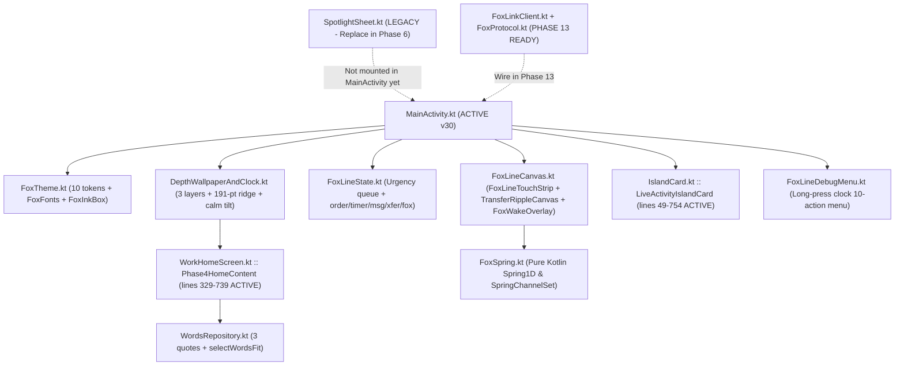

# Complete File-by-File Map Index

Back to Main Brain: [[../../PROGRESS|PROGRESS.md]] | Hub: [[00_Fox_Mobile_Progress_Hub]]

> [!TIP] Why This Map Exists
> Instead of an AI agent reading 6,000+ lines of Kotlin, Swift, HTML, and JSON schemas on every cold start, these 5 linked notes document **every file in the repository**, its exact line ranges, its classes/functions, and whether it is **ACTIVE (`v30`)**, **LEGACY (to be replaced in Phase 6)**, or **PHASE 13 READY**.

---

## Deep File Maps by Subsystem

1. **[[Fox_Mobile_App_And_Core]]** — Build files, `MainActivity.kt`, `FoxSpring.kt`, `FoxTheme.kt`, `Phase2DebugScreen.kt`
2. **[[Fox_Mobile_Depth_And_Home]]** — `DepthWallpaperAndClock.kt`, `WordsRepository.kt`, `WorkHomeScreen.kt`
3. **[[Fox_Mobile_Line_And_Island]]** — `FoxLineState.kt`, `FoxLineCanvas.kt`, `IslandCard.kt`, `FoxLineDebugMenu.kt`
4. **[[Fox_Mobile_Pending_Phase6_To_13]]** — `SpotlightSheet.kt` *(Legacy — replace in Phase 6)*, `FoxProtocol.kt`, `FoxLinkClient.kt`, `ContractTest.kt`, `apps/fox-desk/*`, `packages/fox-protocol/*`
5. **[[Prototype_Source_Of_Truth]]** — Exact line-by-line index into `docs/prototypes/Fox_Line_v30.html` (`1,400+` lines) for Phases 1–8.

---

## Visual Dependency Graph of `apps/fox-mobile`

